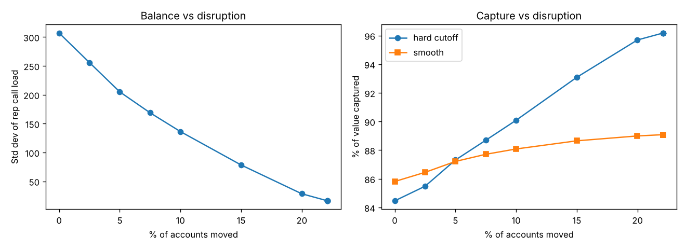

# Sales Territory Realignment & Field Force Sizing
*Built on real CMS Medicare Part D prescriber data — Ohio oral anticoagulants*

**Interactive dashboard:** [Tableau Public](https://public.tableau.com/app/profile/hrishika.j/viz/SalesTerritoryRealignment/Dashboard)



## The question
A specialty sales force covers anticoagulant prescribers across Ohio. Over the
years its territories drifted. Three questions:
1. **Is the imbalance real, and is it measured properly?**
2. **If we fix it, what does the fix cost in disruption?**
3. **Is the headcount right at all?**

## Data
| Layer | Source |
|---|---|
| Prescribers, value, specialty, city | **Real** — CMS Medicare Part D Prescriber data 2014 (BigQuery public dataset `cms_medicare.part_d_prescriber_2014`), Ohio, rivaroxaban / apixaban / warfarin, aggregated per NPI |
| Region | City → 5 metro regions (hand-built mapping, `src/geo.py`) |
| Rep territories (baseline) | **Synthetic** — no company publishes who covers which doctor; a legacy-drift model creates a realistic uneven map |
| Capacity, call plan, costs | Assumptions, all in `config.py` |

See `DATA_NOTES.md` for every cleaning decision.

## Method
- **Target universe:** prescribers with ≥ $2,500 annual drug cost (3,282 of 7,759; 95.6% of value).
- **Workload:** planned calls by value tier — A (top 20%) 24/yr, B (next 30%) 12/yr, C 6/yr. Capacity 800 calls/rep/yr on this brand.
- **The metric critique:** "reps over capacity" counts who crossed the line, not by how much, so it is *magnitude-blind*. Replaced by **total excess calls** = Σ max(0, load − capacity).
- **Capture models:** hard cutoff `min(1, capacity/load)` and smooth `1 − exp(−2.303 · capacity/load)`, always reported side by side.
- **Rebalance:** region-constrained greedy; each step moves the *lowest-value* account of the most-loaded rep to the least-loaded rep — protecting key relationships.
- **Frontier:** the same rebalance under move caps of 0–50% of accounts.
- **Sizing:** for 30–80 reps, build a balanced map from scratch; profit = 70% × captured value − reps × cost, at three rep-cost levels.
- **Sensitivity:** capacity from 500 to 1,200 calls under both curves.

## Results at a glance
- **Concentration:** 6.8% of prescribers drive 50% of value; cardiology is 22% of targets but 48.5% of value.
- **Imbalance:** rep workload CV 37% → 2%; total excess calls −75% (5,772 → 1,420).
- **The metric was wrong:** reps over capacity went *up* (27 → 40) while total overload fell 75% — the realignment spread a small residual overload thinly, which a threshold count reads as getting worse.
- **Value captured:** +3.3 pts (smooth, ≈ $1.8M) to +11.7 pts (hard cutoff, ≈ $6.6M).
- **Disruption:** 22.1% of accounts moved but only 7.9% of value; zero top-decile accounts moved.
- **Frontier:** a 10% move cap delivers 48–69% of the benefit; 15% delivers 74–87%.
- **Sizing:** under-sized at every rep cost tested — optimum 50–65 reps vs 45 — but profit is flat near the peak.

Full numbers with caveats: `RESULTS.md`.

## Run it
Requires Python 3.9+.
```
pip install -r requirements.txt
python run_all.py        # analysis, out/*.csv, out/*.png, acceptance checks
python sql/run_sql.py    # descriptive SQL (MySQL 8 / SQLite compatible)
```

## Repository layout
```
config.py            every assumption, in one file
run_all.py           one command: clean -> baseline -> rebalance -> frontier -> sizing -> sensitivity
src/                 clean.py, geo.py, model.py, frontier.py, sizing.py, sensitivity.py
sql/                 descriptive SQL (CTEs, window functions) + runner
data/clean/          BigQuery extract (input) and generated account/rep tables
out/                 Tableau-ready CSVs, sanity-check charts, headline.json
```

## Outputs (Tableau-ready, in `out/`)
`frontier.csv` · `sizing.csv` · `capacity_sensitivity.csv` · `alignment_compare.csv` · `moved_accounts.csv` · `specialty_summary.csv` · `headline.json` · sanity-check PNGs.

## Limitations
- **2014 data**, Medicare Part D only — apixaban (Eliquis) was early in launch; commercial prescribing is absent.
- **Suppression:** CMS drops prescriber–drug rows below 11 claims, so light prescribers are under-represented.
- **Baseline territories are synthetic**; findings about the realignment are about the method, not a real company.
- **Response curve assumed, not estimated**; both forms reported to show the conclusion holds.
- **Capacity, call plan, margin and rep cost are assumptions** (`config.py`); capacity and cost are swept.
- **Geography is city-level only** — no drive time or contiguity within regions.
- **Uniform rep skill**; **greedy ≠ global optimum**.
- Part D drug cost is a proxy for brand revenue, and includes generic warfarin.
